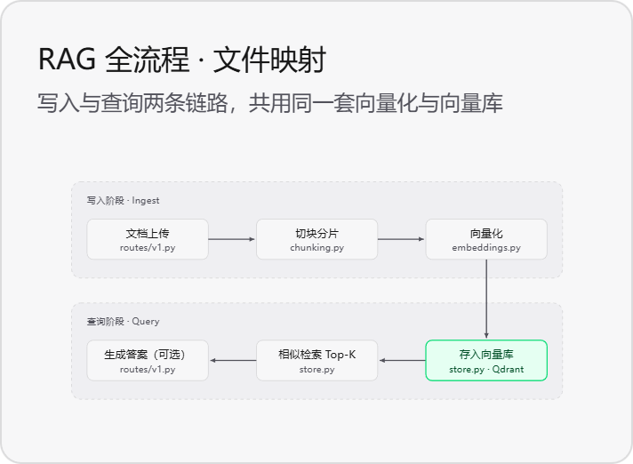

# Day 01 · RAG + FastAPI 项目依赖全景图

> **一句话总纲**：前端提请求 → **uvicorn** 收网络包 → **FastAPI** 定接口 → **pydantic** 验数据 → **sentence-transformers** 把文字变向量 → **qdrant-client** 指挥 **Qdrant** 存取与检索。
> 所有概念都是为这条链路服务的，认识它们最好的方式是问：**「它在这条链路上站哪一站？」**

---

## RAG 的全流程



> [!quote] 图的原话
> 写入与查询两条链路，**共用同一套**量化与向量库。
> 这一句是整个项目最重要的架构判断，下面拆开看。

### 两条链路，六个节点

| 阶段 | 环节 | 落地文件 | 对应工具 |
| :--- | :--- | :--- | :--- |
| **写入 Ingest** | ① 文档上传 | `routes/v1.py` | FastAPI + uvicorn + python-multipart |
| | ② 切块分片 | `chunking.py` | 纯 Python 文本处理 |
| | ③ 向量化 | `embeddings.py` | sentence-transformers |
| **共用节点** | ④ 存入向量库 | `store.py` · Qdrant | qdrant-client → Qdrant |
| **查询 Query** | ⑤ 相似检索 Top-K | `store.py` | qdrant-client（Search） |
| | ⑥ 生成答案（可选） | `routes/v1.py` | LLM 接口 |

### 这张图读出的三件事

1. **写入链路是「单向往下」**：文档进来 → 切成块 → 变成向量 → 落库。走完这一步，Qdrant 里就有货了。
   图里 ③→④ 那条**向下折的箭头**，正是两条链路的接缝——写入的终点就是查询的起点。

2. **查询链路是「反向往上取」**：先把提问**用同一个 ③ 向量化**（图里没有重画，因为它复用了 `embeddings.py`），再用 ④ 这个入口去 ⑤ 检索 Top-K，最后交给 ⑥ 生成答案。

3. **④「存入向量库」被画成绿色，因为它是唯一的物理出入口**：`store.py` 同时承担「写」和「查」，是全部数据的落地点。

> [!tip] 为什么要关心「共用」
> 两条链路共用 `embeddings.py`，意味着**写入时和提问时必须用同一个 embedding 模型**。不同模型的向量空间互不相通，用 A 模型存、用 B 模型查，检索结果会彻底失效。这也是第 2.3 节「维度必须对齐」的根本原因。
> 另外 ⑥ 标了「可选」：只做检索验证（RAG 里的 R）时可以完全不接 LLM，项目照样能跑出可评估的结果。

---

## 0. 前置概念：依赖的两种身份

在 `pyproject.toml` 里，依赖被分成两类，区别只有一句话：**生产环境跑起来时，缺了它行不行？**

| 类型 | 位置 | 包含什么 | 生产环境 |
| :--- | :--- | :--- | :---: |
| **开发依赖** | `project.optional-dependencies` | 修改 / 复刻项目、测试、调试、代码检查、构建时用的工具（pytest、ruff、mypy 等） | ❌ 可以不装 |
| **运行依赖** | `project.dependencies` | 项目跑起来、对外提供服务时**必须**装的依赖 | ✅ 必需 |

> [!info] 补充
> 判断标准就是「上线时删掉它，服务会不会挂」。会挂 → 运行依赖；只是没法跑测试 / 没法做代码检查 → 开发依赖。

### 0.1 前端与后端的分工

- **前端**：负责展示和交互（浏览器、手机 App）
- **后端**：负责处理和计算（本项目的 RAG 逻辑 + FastAPI）

---

## 1. 接口层

### 1.1 FastAPI —— 前后端之间约定的入口

> [!quote] 原笔记的一处口径需要修正
> 原话「FastAPI 负责的是接收到前端请求之后该怎么交给后端处理（怎么调用后端服务得到结果）」——**方向要澄清一下**：FastAPI 本身就运行在后端进程里，它不负责「调用后端服务」，而是负责**把后端函数暴露成一个规范的 HTTP 接口**，并定义「收到什么样的请求 → 交给哪个函数 → 返回什么样的响应」。

因为前端（网页、App，或你测试用的工具）**不能直接伸手进 Python 代码里调用函数**，它必须通过一个**约定的入口**发请求。FastAPI 就是这个入口：把后端服务包装成 HTTP 接口给前端用。

对应上图：**① 文档上传** 和 **⑥ 生成答案** 都写在 `routes/v1.py` 里——这个文件就是 FastAPI 的路由层。

### 1.2 uvicorn —— FastAPI 的黄金搭档（ASGI 服务器）

**FastAPI 自己不会做的四件事**，全都是服务器的活儿：

- ❌ 监听 8000 端口
- ❌ 接收 TCP 连接
- ❌ 解析 HTTP 原始字节
- ❌ 把响应写回网络

所以这些活得交给 **uvicorn**：它是一个高性能的 **ASGI 服务器**，负责监听网络端口、接收 HTTP 请求，把请求转交给 FastAPI 处理，再把处理结果**包装成符合 HTTP 协议的响应**回传给前端。

两者的关系是标准的**分层协作**——uvicorn 管网络，FastAPI 管接口，ASGI 是它们之间约定好的接口规范（换成别的 ASGI 服务器如 hypercorn，FastAPI 照样能跑）。

```
浏览器 / App / 测试工具
        │  HTTP 请求（原始 TCP 字节）
        ▼
   ┌──────────  解析报文、管理连接
   │ uvicorn  │  ← ASGI 服务器（网络层）
   └────┬─────┘
        │  ASGI scope / receive
        ▼
   ┌──────────┐  路由匹配、依赖注入
   │ FastAPI  │  ← Web 框架（接口层）
   └────┬─────
        │  校验后的 Python 对象
        ▼
   ┌──────────
   │ 你的代码 │  ← RAG 业务逻辑（应用层）
   └────┬─────┘
        │  响应经 uvicorn 包装成 HTTP
        ▼
   返回给前端
```

> [!tip] 常见写法
> `uvicorn main:app --reload --port 8000`，其中 `app = FastAPI()` 就是 uvicorn 要驱动的那个 ASGI 应用对象。

### 1.3 pydantic —— 数据校验器

FastAPI 调用的检验数据工具。当 FastAPI 接收到 uvicorn 解析出来的数据之后，如果该接口定义了 **pydantic 模型**，它会先校验数据是否符合要求：

- **不符合** → 告诉 FastAPI，FastAPI 返回 **422 Unprocessable Entity** 错误
- **符合** → 把原始数据转换成带类型的 Python 对象，交给业务函数

> [!info] 补充
> pydantic 不只管「入口校验」，出口也一样：响应模型（`response_model`）会用它来过滤和序列化返回值。v2 版本的底层校验由 Rust 写的 `pydantic-core` 完成，这也是它快的原因。

### 1.4 python-multipart —— 文件格式翻译官

FastAPI 只看得懂普通的 JSON 请求。倘若是文件上传或表单（`multipart/form-data`、`application/x-www-form-urlencoded`）这类它看不懂的内容，就会调用 python-multipart，把这些数据转换成 FastAPI 能处理的形式。

> [!warning] 注意
> 只要代码里出现 `UploadFile` 或 `Form(...)`，就必须装它，否则 FastAPI 会在**启动或调用该接口时直接报错**，提示 `Form data requires "python-multipart" to be installed`。

> [!info] 对应上图
> 它就是为 **① 文档上传** 这一个节点存在的——上传 PDF / Markdown 走的是 multipart，不是 JSON。

---

## 2. 检索层

### 2.1 Qdrant vs. qdrant-client —— 服务器与遥控器

| 名字 | 是什么 | 不是什么 |
| :--- | :--- | :--- |
| **Qdrant** | 用 Rust 编写的高性能**向量搜索引擎**（向量数据库），真正负责存储和计算 | 不是 Python 库 |
| **qdrant-client** | 一个 Python 库，你用来**指挥** Qdrant 干活的工具 | **不是**数据库本身 |

`qdrant-client` 提供了一套 Python 接口，让你不用去拼原始的 HTTP 请求，就能完成所有操作。这就是经典的**客户端—服务器架构**：Qdrant 是服务器，`qdrant-client` 是你手里的遥控器。

### 2.2 qdrant-client 的三件事 = RAG「检索」环节的核心操作

| # | 操作 | 内容 | 上图位置 |
| :---: | :--- | :--- | :---: |
| 1 | **创建「仓库」（Collection）** | Qdrant 里数据按集合组织，可理解成一张表。`qdrant-client` 帮你创建集合并定义向量**维度**（如 384 / 768 维）与**相似度度量方式**（如余弦相似度） | ④ 之前 |
| 2 | **「存入」向量（Upsert）** | 文档切块并向量化后，把向量连同原始文本、来源等**元数据（Payload）**一起上传存入集合 | **④** |
| 3 | **「搜索」相似向量（Search）** | 用户提问时把问题也向量化，再搜索，快速返回最相似的几个向量（**Top-K**）及对应原始文本片段 | **⑤** |

> [!info] 补充：为什么维度必须对齐
> 集合定义的向量维度，必须和 embedding 模型输出的维度完全一致（例如 `all-MiniLM-L6-v2` → 384 维；`bge-m3` → 1024 维）。换模型时若维度变了，只能重建集合并**重新灌入全部向量**。

### 2.3 一个文件两个动作：`store.py` 为什么同时出现在 ④ 和 ⑤

上图把 `store.py` 标在「存入向量库」和「相似检索 Top-K」两处，不是画图偷懒——它正是 `qdrant-client` 三个操作的统一封装层：`create_collection` 建库、`upsert` 写入、`search` 检索。把对 Qdrant 的所有读写收进一个文件，好处是**换向量库时只改这一处**，上层的 `chunking.py` / `embeddings.py` / `routes/v1.py` 全都不用动。

---

## 3. 向量化层

### 3.1 sentence-transformers —— 把「文本」变成「向量」

负责文本向量化的 Python 库，核心技术是**预训练的 Embedding 模型**。上图的 **③ 向量化** 就是它，落在 `embeddings.py`。

> [!quote] 原笔记的定位很准确
> 没有它，Qdrant 里就没有东西可存，检索也无从谈起。

> [!info] 补充：和 LLM API 的区别
> 它是**本地推理**，不联网、不调外部收费 API，模型权重下载一次后即可离线跑。所以它和 Qdrant 一样，通常要用 Docker 单独包一层（见第 4 节），或者放进同一个镜像里。

---

## 4. 部署层

### 4.1 Dockerfile —— 一个集装箱的建造图纸

**把项目和运行环境打包成镜像（集装箱）的说明书**。目的是：**以后不管搬到哪台电脑，打开镜像就能直接跑。**

它只回答一个问题：*这一个集装箱里面装什么、怎么装、启动时跑什么命令。*

按顺序执行：

```
选基础环境 → 设参数 → 装系统工具 → 装运行依赖
          → 复制代码 → 声明端口 → 设健康检查 → 设启动命令
```

### 4.2 docker-compose.yml —— 多集装箱编排说明书

`Dockerfile` 是「怎么打包**一个**集装箱」，而 `docker-compose.yml` 是「**要几个集装箱，每个怎么造，怎么把它们一起开起来，并且让它们互相能说话**」。

| 文件 | 比喻 | 回答的问题 |
| :--- | :--- | :--- |
| **Dockerfile** | 一个集装箱的**建造图纸** | 这一个集装箱里装什么、怎么装、启动跑什么 |
| **docker-compose.yml** | 整个店的**运营计划书** | 开几个集装箱？用图纸造还是买现成的？怎么连？谁先启动？端口怎么开？数据存哪？ |

> [!important] 关键规则
> 如果有两个集装箱要自己造，但**造法不同**，**那就需要两份 Dockerfile**。
> 反过来：`docker-compose.yml` 通常只需一份，它负责引用这些图纸和现成镜像。

> [!tip] 对应上图
> 图里 `Qdrant` 出现在 ④，它就是那份「运营计划书」里的一个**买现成的集装箱**（官方镜像 `qdrant/qdrant`，无需写 Dockerfile）；而你的 API 服务是**按图纸自己造的集装箱**。所谓「让它们互相能说话」，在代码里就是 `store.py` 连的是 `http://qdrant:6333` 这个容器内网地址，而不是 `localhost`。

### 4.3 文件不能随便放：最常见的组织方式

```
项目根目录/
├── api/
│   ├── Dockerfile        ← api 的图纸
│   └── ...代码
├── worker/
│   ├── Dockerfile        ← worker 的图纸
│   └── ...代码
└── docker-compose.yml    ← 编排文件，放在根目录
```

> [!info] 补充
> 图纸必须和它服务的代码放在同一个「构建上下文」目录里，因为 `COPY` 指令只能访问上下文内的文件。`docker-compose.yml` 则固定在根目录，靠 `build.context` 字段指向各服务的上下文路径。

---

## 附：整理说明

本次只做排版重构与措辞顺句，**未删减、未替换任何原有观点**。改动清单：

| 改动 | 类型 | 说明 |
| :--- | :--- | :--- |
| 新增「RAG 的全流程」章节与流程图 | 新增 | 图片存于 `assets/rag-flow-ingest-query.png`（712×522，无损），置于开篇作为全篇导览，并回链到后续各节 |
| 2.3 节 `store.py` 的双重角色 | 新增 | 由图中 `store.py` 同时出现在 ④⑤ 推得，属对图的解读，非你原有观点 |
| 各节末尾「对应上图」标注 | 新增 | 把依赖清单钉回图上的具体节点，方便对照项目源码 |
| 「FastAPI 负责怎么调用后端服务得到结果」 | **纠正** | 澄清为「把后端服务包装成 HTTP 接口」，FastAPI 本身已在后端进程内，不存在调用后端服务 |
| 「FastAPI 只看懂 JSON」 | **保留原意** | 该说法在面向初学者时成立（默认请求体按 JSON 解析），故不作删改，仅补充 `Form`/`UploadFile` 场景的报错提示 |
| 分层结构（0–4 节） | 新增 | 按「接口层 / 检索层 / 向量化层 / 部署层」归类，原内容一条不落 |
| uvicorn—FastAPI—业务逻辑流程图 | 新增 | 把原文第 7、9 两条的文字描述画成链路图 |
| Qdrant 与 qdrant-client 对照表 | 新增 | 原文即「服务器 vs. 遥控器」的对比表述，改为表格 |
| Dockerfile 与 compose 对照表 | 新增 | 原文第 22–26 条已是同一组对比，合并去重 |
| 依赖类型表格、embedding 维度对齐、pydantic 出口校验、sentence-transformers 本地推理 | **补充** | 均为对原文观点的自然延伸，标注为 `[!info] 补充` |
| 失效的外链锚点（`mintlify.wiki/qdrant/...#next-steps`） | 移除 | 指向页面底部 Next steps 区块，与所在条目内容无关 |

原始版本已备份为 [[Day01.orig.bak.md]]，对照无误后可删除。
