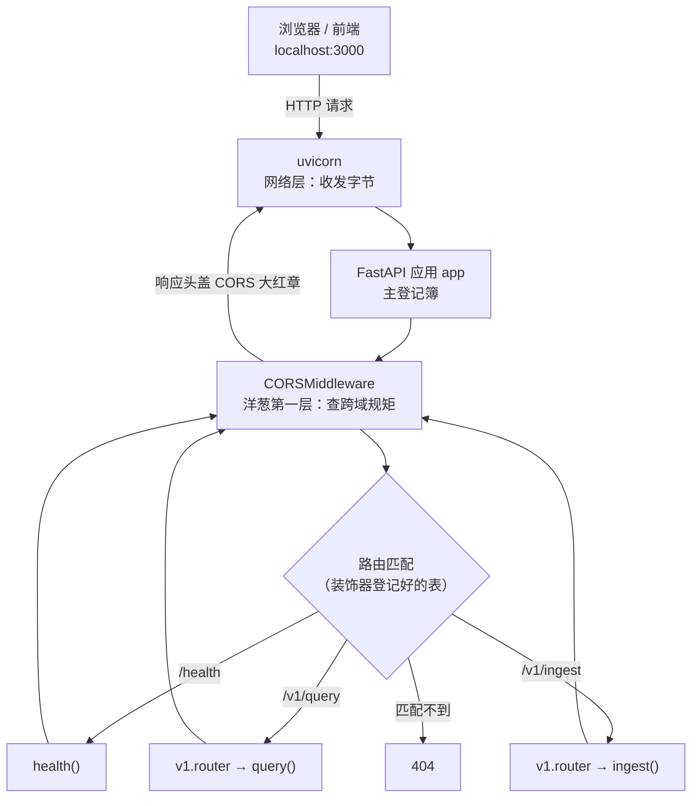
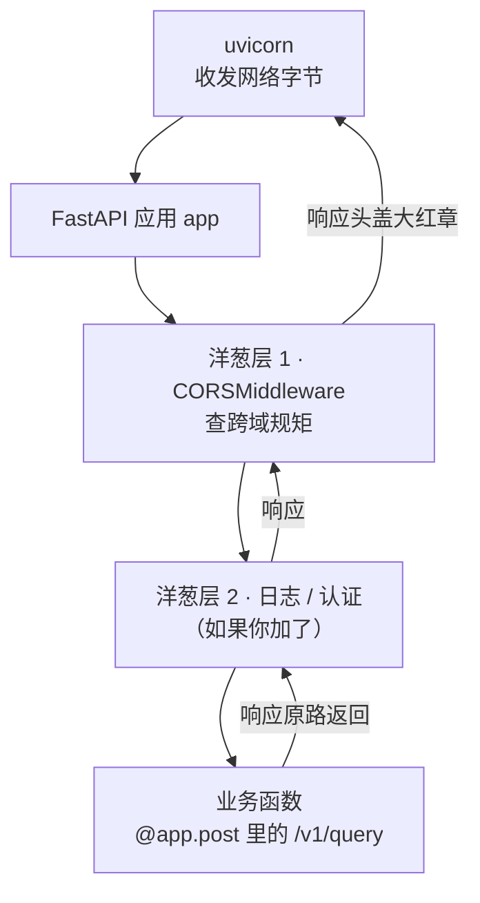
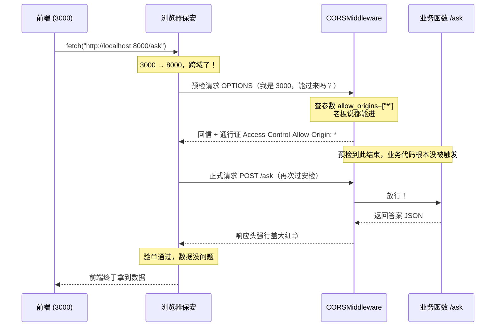
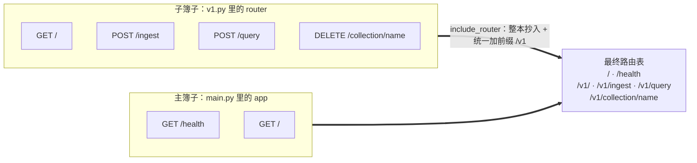

> **一句话总纲**：`main.py` 只干三件事——用**装饰器**登记接口、用**中间件**统一管进出、用 `include_router` 把分册并回主册。
> 三者背后是同一个设计哲学：**重复的机械劳动交给前人写好的机制，你只负责填参数。**

| 机制 | 在 `main.py` 的位置 | 一句话职责 |
| :--- | :--- | :--- |
| **装饰器** `@app.get` / `@router.post` | 第 40、46 行；`v1.py` 全文 | 声明「什么请求 → 交给哪个函数」 |
| **中间件** `app.add_middleware(CORSMiddleware, ...)` | 第 24–29 行 | 对所有请求做**全局**预处理 / 后处理 |
| **路由聚合** `app.include_router(...)` | 第 56 行 | 把 `v1.py` 这本「分册」并进主册并加前缀 |

---

## 〇、导览：一个请求在 main.py 里的路径



看懂这张图，就看懂了本文三节的关系：**中间件管「进出」，装饰器管「找谁」，`include_router` 管「表从哪来」。**

---

## 一、装饰器：把功能「挂」在函数头上

### 1.1 定义

**装饰器就是一个「包装盒」，用 `@` 符号套在函数头上，能在不修改原函数代码的情况下，给函数动态添加额外功能。**

在 FastAPI 里，它主要用来告诉服务器：**「这个函数是处理哪个接口的」**。

### 1.2 日常代码里的两步用法

**第一步：先在外面写好要新增的功能**

```python
def add_time_and_memory(func):          # 接收一个参数，名字叫 func
    def wrapper():
        print("--- 加时间 ---")
        func()                          # 这里的 func 就是你传进来的那个函数
        print("--- 加内存 ---")
    return wrapper
```

**第二步：再将新写好的功能挂载到原函数上**

```python
@add_time_and_memory
def say_hello():
    print("你好呀！")

say_hello()
# --- 加时间 ---
# 你好呀！
# --- 加内存 ---
```

### 1.3 `@` 语法糖背后悄悄发生的事

当你写 `@add_time_and_memory` 时，Python 在后台做了一件事：

> **它把 `say_hello` 这个函数本身，当作一个「包裹」，塞给了 `add_time_and_memory` 函数，并且赋值给了 `func` 这个变量。**

等价写法只有一行：

```python
say_hello = add_time_and_memory(say_hello)   # @ 只是把这行替你写了
```


所以**被装饰之后，`say_hello` 这个名字已经不再是原来那个函数了**，它是 `wrapper`。原函数只是被 `wrapper` 关在里面，等 `func()` 那一行才被叫出来干活。

### 1.4 在 FastAPI 中：登记路由

```python
@app.get("/health")
def health_check():
    return {"status": "ok"}
```

就是告诉服务器：**遇到 GET 请求、并且路径是 `/health`，就调用下面这个函数执行。**

> [!info] 补充：FastAPI 的路由装饰器是「例外」
> 普通装饰器会把函数换成 `wrapper`；而 `@app.get(...)` 干的事是「把函数登记进路由表，然后**把原函数原样还给你**」。所以你写的 `def health()` 本身没有被替换，照样能被别的代码直接调用——这是 FastAPI 故意设计的，它借的是装饰器的「语法位置」，不是「包装换函数」那半边。

### 1.5 如果没有装饰器：手写路由分发

那就得自己写一大堆路由分发代码（判断 URL 是啥、请求方法是啥、去调哪个函数，一堆 `if-else`），非常痛苦：

```python
def 接客大脑(请求):
    # 痛苦 1：你要手动解析请求是 GET 还是 POST
    if 请求.method == "GET":
        # 痛苦 2：你要手动判断 URL 是什么
        if 请求.url == "/health":
            返回结果 = health_check()
        elif 请求.url == "/ask":
            返回结果 = ask_question()
        else:
            返回结果 = "404 找不到"
    elif 请求.method == "POST":
        if 请求.url == "/upload":
            返回结果 = upload_file()
        # ... 几百个 if-else 嵌套 ...
```

有了装饰器之后，就可以直接使用 FastAPI 写好的路由分发方法，把它挂载在函数上就行：**登记的工作交给了框架，你只声明。**

### 1.6 另一个用法：`@property` 把「动作」伪装成「属性」

假设你写了一个类，里面有个方法叫 `get_full_name()`，用来把姓和名拼起来：

```python
class Person:
    def __init__(self, first, last):
        self.first = first
        self.last = last

    def get_full_name(self):        # 这是一个方法
        return f"{self.first} {self.last}"

p = Person("张", "三")
print(p.get_full_name())   # 打印：张 三
```

注意上面，调用方法**必须带括号** `()`。加上 `@property`：

```python
class Person:
    def __init__(self, first, last):
        self.first = first
        self.last = last

    @property
    def full_name(self):            # 方法名变成了 full_name
        return f"{self.first} {self.last}"

p = Person("张", "三")
print(p.full_name)   # 打印：张 三 （注意：没加括号！）
```

**优点：**

1. **为了代码好看、读起来像自然语言**：`p.full_name` 比 `p.get_full_name()` 更符合人类直觉。
2. **为了安全**：你可以在 `@property` 方法里加逻辑，比如「如果用户没填名字，就返回『匿名』」；同时不允许外面的人随便修改这个名字（相当于**只读属性**）。

> [!tip] 只读的实现原理
> `@property` 只注册了「读」的通道。Python 的规则是：**有 getter 没有 setter 的属性，赋值就报 `AttributeError`**。所以「不能改」不是靠自觉，是解释器拦的。而 `@xxx.setter` 就是**带安检的修改**。

**带安检门的完整例子：**

```python
class Student:
    def __init__(self):
        self.__score = 100          # 双下划线开头的「内部存储」

    @property
    def score(self):                # 唯一的读取窗口
        return self.__score

    # 这就是修改分数的「安检门」
    @score.setter
    def score(self, value):
        if not isinstance(value, int):
            raise ValueError("分数必须是整数！")     # 拦截类型错误
        if value < 0 or value > 100:
            raise ValueError("分数必须在 0-100 之间！")  # 拦截范围错误

        self.__score = value        # 安检通过了，才真正修改

s = Student()
s.score = 85    # 正常通过安检，修改成功
s.score = -10   # 💥 直接报错：分数必须在 0-100 之间！
```

### 1.7 双下划线的作用 —— 为什么它和 `@property` 是「原配夫妻」

> 这是笔记里留给我自己的问题：双下划线干什么用、为什么要和 `@property` 一起用、不一起用的后果。

#### （1）双下划线做了什么：名称改写（name mangling）

在**类内部**写 `self.__score`，Python 会自动把它改名成 `self._类名__score`：

```python
class Student:
    def __init__(self):
        self.__score = 100

s = Student()
# print(s.__score)         # ❌ AttributeError: 'Student' object has no attribute '__score'
print(s._Student__score)   # ✅ 照样打印出 100 —— 说明它没被真的锁住
print(vars(s))             # {'_Student__score': 100}  ← 字典里的真名就是这个
```

所以它的**真正目的不是「加密 / 私有」，而是「防撞名」**：子类里如果也手滑写了 `self.__score`，会被改写成 `_子类名__score`，不会覆盖父类的同名内部变量。它是一块「谢绝来访」的门牌，**不是锁**。

顺带分清三种下划线：

| 写法          | 含义                                  | 解释器管不管           |
| :---------- | :---------------------------------- | :--------------- |
| `score`     | 公开属性，随便访问                           | 不管               |
| `_score`    | 「约定俗成」的内部属性，别从外面动                   | **不管**，只是给同行看的注释 |
| `__score`   | 私有，触发**名称改写**，防止意外覆盖                | **管**，会自动改名      |
| `__score__` | 前后双下划线是**魔法方法专用**（如 `__init__`），别自创 | 特殊语义             |

#### （2）为什么要一起用：一个管「藏」，一个管「门」

两者分工完全不同，缺一个都不成套：

| 部件                | 负责什么                               | 单独存在时的缺口               |
| :---------------- | :--------------------------------- | :--------------------- |
| `self.__score`    | **藏起真正的存储**，让外部（含子类、含别人的代码）不容易随手碰到 | 藏了但没法读、也没法加校验          |
| `@property score` | **对外的唯一读取窗口**                      | 读的时候能加逻辑，但挡不住有人直接改底层变量 |
| `@score.setter`   | **对外的唯一写入窗口，带校验**                  | 同上                     |

合起来才是完整的一句话：**数据只能走这一道门进出。** `__` 保证仓库门牌不挂在外面，`@property` 保证只有一扇带安检的门。

#### （3）只用 `@property`，不用 `__`

```python
class Student:
    def __init__(self):
        self._score = 100              # 单下划线，不改名

    @property
    def score(self):
        return self._score

    @score.setter
    def score(self, value):
        if value < 0 or value > 100:
            raise ValueError("分数必须在 0-100 之间！")
        self._score = value

s = Student()
s._score = -999      # 😄 绕过安检门成功，一点错都不报
print(s.score)       # -999
```

**后果**：门还是那扇门，但仓库门牌明晃晃写着 `_score`，任何知道这个约定的人都能直接从窗户爬进去，**校验形同虚设**。另一个后果是子类同名覆盖：父类内部用 `_score` 存状态，子类也写了 `_score`，父子俩共用一个变量，互相踩。

#### （4）只用 `__`，不用 `@property`

```python
class Student:
    def __init__(self):
        self.__score = 100

s = Student()
print(s.__score)          # ❌ AttributeError，正常的读入口都没有
print(s._Student__score)  # 只能这么丑陋地读
s._Student__score = "不及格"  # 不但能改，连类型都保不住，还没有任何拦截
```

**后果**：等于把数据锁进抽屉、连自己都拿不出来。既没有干净的读取接口，也没有任何插逻辑的地方（越界拦截、默认值、只读保护、懒加载，全都无处安放）。

#### （5）一个必踩的坑：`__init__` 里写 `self.score = 100`

```python
class Student:
    def __init__(self):
        self.score = 100          # ❌ 这是 property 名，不是存储名

    @property
    def score(self):
        return self.__score
    # 没有 setter
# AttributeError: property 'score' of 'Student' object has no setter
```

`self.score` 命中的是 `@property` 那扇门，而不是存储变量。所以初始化时**必须写内部名** `self.__score = 100`；或者反过来——**故意**写 `self.score = 100`，让初始值也走一遍 setter 的安检（前提是你确实定义了 setter）。

### 1.8 补充：想写通用装饰器，还差两个零件

1.2 节那个例子只能包装**无参数**的函数，一传参数就崩。真实写法要加 `*args / **kwargs`，并用 `functools.wraps` 保住函数原名：

```python
import functools

def add_time_and_memory(func):
    @functools.wraps(func)                 # 保住 __name__ / __doc__ 等元信息
    def wrapper(*args, **kwargs):          # 任意参数都能透传
        print("--- 加时间 ---")
        result = func(*args, **kwargs)
        print("--- 加内存 ---")
        return result                      # 别忘了把返回值还回去
    return wrapper

@add_time_and_memory
def say_hello(name):
    print(f"你好呀，{name}")

print(say_hello.__name__)   # 没有 wraps 会打印 'wrapper'，有了才是 'say_hello'
```

> [!warning] 为什么在 FastAPI 项目里要特别在意这一点
> 被装饰函数的名字和文档字符串会变成 API 的 **operation id** 和 OpenAPI 文档里的说明。要是自定义装饰器不写 `@functools.wraps`，`/docs` 页面上就会一排 `wrapper`，日志和报错栈里也一样分不清谁是谁。

---

## 二、CORSMiddleware：全局进出口的「加工厂」

### 2.1 Middleware 是什么

它的名称叫**中间件**，是**夹在服务器（uvicorn）和应用（FastAPI）中间的一个「加工厂」**，主要用于**全局的请求预处理**（如 CORS 跨域、身份认证、请求日志记录）和**响应的后处理**，**对全局生效**。

> [!info] 补充：物理位置的澄清
> 「夹在 uvicorn 和 FastAPI 中间」抓住的是**效果**（所有请求都得先过它），不是进程的物理排布。严格说，Starlette/FastAPI 的中间件运行在**应用内部**、路由匹配**之前**，是一个「洋葱模型」：
> `uvicorn（收发字节） → FastAPI 应用 → 中间件洋葱层 → 路由函数`
> 换句话说：中间件不是额外的进程，它就是你的应用代码里多包了几层的那个「几层」。



### 2.2 为什么要有中间件？没它不行吗？

**没它也行，但你会累死。**

假设你项目里有 20 个接口（`/upload`、`/ask`、`/history`……）：

- **没有中间件**：你得在每一个接口的函数里，都手写一遍「检查跨域」「验证用户登录」。写 20 遍，又累又容易漏。
- **有了中间件**：只要在外面配置一次。请求一进来，先统一被中间件拦截处理，处理完再自动分发给后面的接口。**代码极其清爽。**

### 2.3 它和装饰器异曲同工

都可以直接使用**前人写好的方法，只要改参数就行**。但两者管的维度不一样：

| 对比 | 装饰器 | 中间件 |
| :--- | :--- | :--- |
| 作用范围 | **单个函数**（挂谁身上管谁） | **全局**（所有请求都过一遍） |
| 管的事 | 「这个请求交给哪个函数」 | 「请求进门前、出门后要统一做什么」 |
| 写法 | `@app.get("/health")` | `app.add_middleware(CORSMiddleware, **参数)` |
| 共同点 | 复用前人机制，你只填参数 | 复用前人机制，你只填参数 |

### 2.4 为什么每个接口都要检查？不检查不行吗？

1. **防黑客**：防止跨站请求伪造（CSRF）、恶意刷接口、爬虫。
2. **防小人**：防止没买会员的人，偷偷调用你付费的高级功能。
3. **防瞎搞**：防止前端给你传了一堆垃圾数据（比如把上传文件写成了 10 个 G），把你的服务器撑爆。

> [!warning] 两处术语修正
> 1. **CSRF = 跨站请求伪造**；**跨站脚本攻击是 XSS**，两个是不同的东西，原笔记把中文说反了。
> 2. 上面这三类防护，**主力不是 CORSMiddleware**：防小人靠**认证中间件 / 依赖注入**，防瞎搞靠 **pydantic 校验 + 体积限制**，防刷靠**限流中间件**，防 CSRF 主要靠 **Cookie 的 `SameSite` / CSRF token**。CORS 只负责一件事——**告诉浏览器「哪些来源允许读我的响应」**。这里保留原意，是因为它回答了同一个问题：为什么需要一层全局检查。

### 2.5 CORSMiddleware 解决的是「同源策略」

**同源**指三样完全一模一样：

| 要素 | 例子 |
| :--- | :--- |
| **协议** | `http` / `https` |
| **域名（IP / 网址）** | `localhost` / `127.0.0.1` / 具体 IP |
| **端口号** | `3000` / `8000` |

> [!important] 只要有一个不一样，就是跨域（跨源）；只要不同源，浏览器就不让你随便拿响应。
> 目的是：**保护你的 Cookie、登录状态不被偷走。**

`http://localhost:3000`（前端）请求 `http://localhost:8000`（后端）→ **端口不同 → 跨域**。

所以 **CORSMiddleware** 就是用来解决这个问题的：前人写了一套叫 **CORS 的跨域规则**，把它**挂载到中间件**上面去，我们只要**改一改参数**就可以用了。这也说明——**还有别的规则可以挂载到中间件上面去**。

> [!info] 补充两个容易误解的点
> 1. **同源策略是浏览器对「前端 JS 发的请求」的限制**。用 Postman、curl、另一个后端服务来调你的接口，永远不会遇到 CORS——这就是「浏览器里报错、Postman 正常」的由来。
> 2. 默认行为更准确的说法是：**请求可能照发，但浏览器禁止前端读取跨域响应**；只有「非简单请求」才会先发的 `OPTIONS` 预检（见下节第五幕与 2.7）。

### 2.6 生活化例子：一次跨域请求的五幕剧



#### 🎬 第一幕：前端出门，保安拦截（浏览器层面）

1. 前端写好代码：`fetch("http://localhost:8000/ask")`。
2. 浏览器（保安）一看：出发地是 `3000`，目的地是 `8000`，**跨域了！**
3. 出于安全考虑，浏览器**不直接发送真正的业务请求**。它先自动帮你发一个**「预检请求（OPTIONS）」**，相当于问一句：「嘿，8000 端口，我是 3000 端口，我能过来吗？」

#### 🎬 第二幕：请求进门，中间件查规矩（后端层面）

1. 这个「预检请求」经过 uvicorn，到达了你的 FastAPI 应用。
2. 注意！它**没有**直接去 `/ask` 的函数，而是**先撞上了 `CORSMiddleware`**。
3. 中间件拿出你给的参数（`allow_origins=["*"]`）看了看，说：「老板说了，所有端口都能进。」
4. 中间件**直接给浏览器回了一封信**：「可以，你让他来吧。」（这封信里带着 `Access-Control-Allow-Origin: *` 等通行证）。

> **注意：** 预检请求到这里就结束了，中间件直接把它挡下并回复了，**业务代码（`/ask` 函数）根本没被触发**。

#### 🎬 第三幕：正式出击，再次过安检

1. 浏览器保安收到了中间件的回信，确认安全，于是**真正地**把业务请求（`POST /ask`）发了出来。
2. 请求再次到达后端，**又一次经过 `CORSMiddleware`**。
3. 中间件一看：「是正式请求，规矩符合，**放行！**」
4. 请求终于到达了 `@app.post("/ask")` 下面的业务函数。你的 RAG 逻辑开始跑，去检索、去调大模型，算出了答案。

#### 🎬 第四幕：原路返回，盖章放行

1. 业务函数把答案（JSON）交回给 FastAPI。
2. 在把答案发回给浏览器之前，**再次经过 `CORSMiddleware`**。
3. 中间件做最后一步：**在返回的响应头（Header）里，强行盖上一个大红章**（`Access-Control-Allow-Origin: *`）。
4. uvicorn 把这个盖了章的响应发回给浏览器。

#### 🎬 第五幕：保安验章，大结局

1. 浏览器保安收到了后端的响应。
2. 保安检查响应头，看到了中间件盖的那个「大红章」。
3. 保安点点头：「嗯，后端确实同意跨域了，这数据没问题。」
4. **放行！** 前端网页终于拿到了数据，把答案展示给用户。

> [!question] 那第一幕说「不直接发真正的请求」，是不是所有跨域请求都先发预检？
> **不是。** 只有**非简单请求**才发预检，判定标准是三条同时满足才算「简单」：
> - 方法是 `GET` / `POST` / `HEAD`
> - `Content-Type` 只能是 `text/plain`、`application/x-www-form-urlencoded`、`multipart/form-data`
> - 不带自定义 Header（如 `Authorization`）
>
> **简单请求**：直接发出去，**没有预检**；浏览器只在拿到响应后检查有没有那个「大红章」，没有就不给前端读（你会看到控制台报错，但后端日志里函数其实跑了）。
> **非简单请求**：如 `Content-Type: application/json`、带 token 的 `Authorization`、`PUT` / `DELETE` —— 才会先 `OPTIONS` 预检，也就是上面五幕剧演的那种情况。

### 2.7 对应到本项目的真实接口

`main.py` 第 24–29 行的实际配置：

```python
app.add_middleware(
    CORSMiddleware,
    allow_origins=["*"],                      # 允许所有来源（开发环境）
    allow_methods=["GET", "POST", "DELETE"],  # 允许的请求方法
    allow_headers=["*"],                      # 允许所有请求头
)
```

对照本项目 `v1.py` 的三个接口，五幕剧各自上演几幕：

| 接口 | 实际完整路径 | 类型 | 会先发预检吗 |
| :--- | :--- | :--- | :--- |
| `@router.get("/")` | `GET /v1/` | 简单请求 | ❌ 不会，直接发，响应靠浏览器验章 |
| `@router.post("/ingest")` | `POST /v1/ingest`（`multipart/form-data`） | 简单请求 | ❌ 不会 |
| `@router.post("/query")` | `POST /v1/query`（`application/json`） | **非简单** | ✅ 会，完整走五幕 |
| `@router.delete("/collection/{name}")` | `DELETE /v1/collection/xxx` | **非简单**（方法不在名单里） | ✅ 会 |

> [!info] 补充
> 原笔记里的 `/upload`、`/ask`、`/history` 是讲概念时举的泛指例子，本项目对应的其实是 **`/v1/ingest`（上传）** 和 **`/v1/query`（提问）**，没有 `/history`——历史检索靠 `collection` 参数区分，没单开接口。

> [!warning] `allow_origins=["*"]` 的安全边界
> - `"*"` 表示「谁来都放行」，**学习 / 本地开发没问题，正式环境要换成白名单**：`allow_origins=["http://localhost:3000", "https://你的域名"]`。
> - **硬规则**：`allow_origins=["*"]` 与 `allow_credentials=True`（带 Cookie 的请求）**互斥**。Starlette 的实现会直接不让两者同时生效，浏览器那边也不会认这个组合。想带 Cookie 就必须写明具体来源。
> - 本项目没开 `allow_credentials`，所以现在这套配置是自洽的。

---

## 三、include_router：把「分册」并回「主册」

### 3.1 作用

`include_router` 也是 FastAPI 写好的方法，作用是：**允许你在主程序里，把其他程序的小本子（记录路由选择的东西）「合并」过来。**

> [!note] 先接上前文的伏笔
> 之前说的**装饰器**在 FastAPI 中的作用是「什么请求应该用什么函数执行」，用来记录这些的就是**创建 FastAPI 实例时自动创建的一个「本子」**（主登记簿 / 路由表）。这一节讲的就是：分册怎么并进主册。

### 3.2 逐参数拆解

拿 `main.py` 第 56 行的代码来讲解：

```python
app.include_router(v1.router, prefix="/v1", tags=["v1"])
```

| 参数 | 是什么 | 出处 |
| :--- | :--- | :--- |
| `v1.router` | 我们自己造的**子登记簿** | `v1.py` 第 21 行 `router = APIRouter()`，其中 `APIRouter()` 也是 FastAPI 的一个类；`v1.py` 里那些 `@router.post(...)` 都是往这本**子簿子**上登记的 |
| `prefix="/v1"` | 给子簿子里所有地址**统一加前缀** | `v1.py` 里写 `@router.post("/query")`，地址是 `/query`；若直接记进主簿子，就分不清路由的归属了，所以要加 `/v1` 前缀 |
| `tags=["v1"]` | **挂个招牌（给文档看的）** | 只影响 `/docs` 里的分组展示，不影响任何路由行为 |

所以 `include_router` 干的事就是：**把 `v1.py` 那本子簿子整本抄进主簿子 `app`，并且给子簿子里所有地址统一加前缀 `/v1`。**



### 3.3 为什么不把所有接口直接写进 main.py

**因为版本管理。**

以后要出 `/v2`，你只要再写个 `v2.py`，加一行：

```python
app.include_router(v2.router, prefix="/v2")
```

老用户继续用 `/v1` 不受影响，并且不用将所有接口全部写进主程序。

### 3.4 那 v1.py 为什么不能用 `app = FastAPI()` 创建「本子」？

因为这两个对象**职责不同**：

| | `FastAPI()` | `APIRouter()` |
| :--- | :--- | :--- |
| **是什么** | 完整应用（主簿） | 可拆分的接口集合（分册） |
| **能被 uvicorn 启动吗** | ✅ 能，`uvicorn app.main:app` 启动的就是它 | ❌ 不能，它只是个登记簿，不是应用 |
| **能合并进别的应用吗** | ❌ 不能 | ✅ 能，`include_router` 就是干这个的 |
| **能挂中间件 / 异常处理器吗** | ✅ 能（`add_middleware`、`@app.exception_handler`） | ❌ 不管这些全局的事，只登记路由 |

如果 `v1.py` 里也写 `app = FastAPI()`，那你就造出了**第二个独立应用**——它跟 `main.py` 里那个 `app` **完全不认识**，`include_router` 也合并不了。最后 uvicorn 只启动其中一个，另一个白写了。

> [!tip] 一句话记住分工
> **一个进程里只该有一个 `FastAPI()`（主簿，负责启动、中间件、异常处理）；`APIRouter()` 可以有很多个（分册，负责按业务 / 版本拆文件）。**

### 3.5 本项目的最终路由表

把上面三节合起来读，`main.py` + `v1.py` 登记出来的完整清单：

| 方法 | 路径 | 处理函数 | 出处 | 文档分组 |
| :--- | :--- | :--- | :--- | :--- |
| `GET` | `/` | `root()` | `main.py:46` | `meta` |
| `GET` | `/health` | `health()` | `main.py:40` | `meta` |
| `GET` | `/docs` | FastAPI 自带 Swagger UI | `main.py:20` | — |
| `GET` | `/openapi.json` | FastAPI 自带的机读接口说明 | `main.py:21` | — |
| `GET` | `/v1/` | `index()` | `v1.py:76` | `v1` |
| `POST` | `/v1/ingest` | `ingest()` | `v1.py:88` | `v1` |
| `POST` | `/v1/query` | `query()` | `v1.py:125` | `v1` |
| `DELETE` | `/v1/collection/{name}` | `delete_collection()` | `v1.py:143` | `v1` |

---

## 四、三节串起来的收束

| 问题 | 答案 | 机制 |
| :--- | :--- | :--- |
| 请求怎么找到函数？ | 装饰器把「路径 + 方法 → 函数」记进登记簿 | **装饰器** |
| 登记簿从哪来？ | `APIRouter()` 写分册，`include_router` 并回主册 | **include_router** |
| 谁来统一做全局把关？ | 挂在应用上的洋葱层，进出各走一遍 | **中间件** |
| 它们的共同点？ | **前人写好的机制，你只负责填参数** | 复用 |

---

## 附：整理说明

本次只做排版重构与措辞顺句，**未删减、未替换任何原有观点**。改动清单：

| 改动 | 类型 | 说明 |
| :--- | :--- | :--- |
| 标题、总纲、三机制速查表 | 新增 | 对齐 [[Day01.md]] 的开篇体例 |
| 〇、导览流程图 + Mermaid | 新增 | 把「装饰器 / 中间件 / include_router」画进同一条请求链路，正文三节都能挂回这张图 |
| 1.3 节 `say_hello = add_time_and_memory(say_hello)` + 映射图 | 补充 | 原文「Python 在后台悄悄做了一件事」的具体化，观点未变 |
| 「`@app.get` 会把函数换成 wrapper」 | **纠正** | 路由装饰器登记后把**原函数原样返回**，不替换函数本体，与普通装饰器不同；已在 1.4 标为补充说明 |
| 1.7 双下划线一节 | **新增（你留的问题）** | 名称改写的真实目的（防撞名，不是加密）、与 `@property` 的分工表、四种拆开设法各自的后果 + 可运行反例、`__init__` 里 `self.score = 100` 会报 `AttributeError` 的坑；原文那句「原配夫妻」的结论保留并展开 |
| 1.8 `functools.wraps` 与 `*args/**kwargs` | 补充 | 原文 `wrapper()` 只能包无参函数，通用写法需补参数透传与元信息保留 |
| 2.1 「夹在 uvicorn 和 FastAPI 中间」 | **纠正（保留原表述）** | 保留你的说法并加位置澄清：中间件运行在应用内部、路由匹配之前，是洋葱层；原文抓住的是效果不是进程排布 |
| 「防黑客：防止跨站脚本攻击（CSRF）」 | **纠正** | CSRF = 跨站请求伪造，跨站脚本攻击是 XSS，原中文说反了；并补注这三类防护的主力各有其人（认证 / pydantic / 限流 / SameSite），CORS 只管「允许哪些源读响应」 |
| 「只要不是同源，默认不准随便发请求」 | **保留原意 + 精确化** | 更准确为「禁止前端**读取**跨域响应」，仅非简单请求才先 `OPTIONS` 预检；已在 2.5、2.6 补充判定标准，五幕剧原文一字未删 |
| 2.6 五幕剧 | **保留原文** | 只把 `---` 分隔的散段收进五个可折叠小标题，并加 Mermaid 时序图；正文措辞未动 |
| 2.7 对照本项目 + `allow_credentials` 冲突 | 新增 | 逐个接口标注是否触发预检；`allow_origins=["*"]` 与 `allow_credentials=True` 互斥为原笔记未覆盖的实配风险 |
| `/upload`、`/ask`、`/history` | **保留原意 + 标注** | 保留为讲概念的泛指例子，另注明本项目实际是 `/v1/ingest`、`/v1/query`，无 `/history` |
| 3.2 参数拆解表 + 并册图 | 新增 | 原文「子簿子 / 主簿子 / 加前缀 / 挂招牌」的表述改成表格 + 图，比喻全部保留 |
| 3.4 `FastAPI()` vs `APIRouter()` | 修正格式 | 原文被压成一行的表格已还原为四行三列表格，并加「能否挂中间件」一行 |
| 3.5 最终路由表 | 新增 | 依据 `main.py`、`v1.py` 实际代码整理，便于回查行号 |
| `def __ init __`、`self.__ score = 100` | **修正笔误** | 应为 `__init__`、`self.__score = 100`（中间不能有空格，否则 Python 语义完全改变） |
| 全部代码块、行内 `code`、callout 配色 | 新增 | 原文代码是裸文本，无法复制运行 |

原始版本已备份为 [[Day02.orig.bak.md]]，对照无误后可删除。
