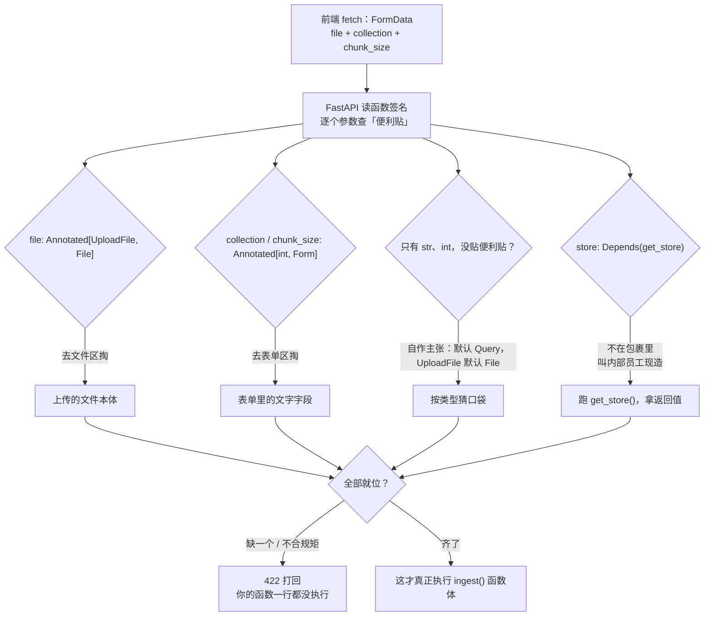
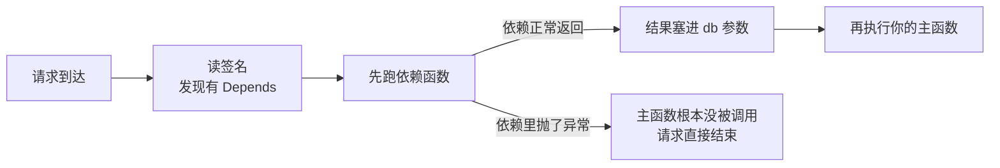

# Day 03 · v1.py 的分析：Annotated 与 Depends

> **一句话总纲**：前端把数据打包送来，后端只需回答两个问题——
> **「去哪找」（`Annotated` + `Form` / `File` / `Query`）** 和 **「谁先给你备好」（`Depends`）**。
> 两者背后是同一个设计哲学：**你只声明「我要什么」，取货和装配全部交给 FastAPI。**

| 符号 | 回答的问题 | 一句话职责 | 本项目出现处 |
| :--- | :--- | :--- | :--- |
| `Any` / `str` / `int` | 这是什么**类型** | 只管类型，不管数据从哪来 | — |
| `Annotated[类型, 指令]` | 类型 **+** 来源 | 把两件事写在同一个括号里 | `v1.py:90–93` |
| `File(...)` / `Form(...)` / `Query(...)` | **去哪找** | 四张「便利贴」，指定包裹区域 | `File`、`Form` |
| `min_length` / `ge` / `pattern` … | **什么规矩** | 交给 Pydantic 当安检尺子 | 本项目改用 `description` |
| `...` | **必须传吗** | 没有默认值 → 缺了就打回 | 隐含在 `File(...)` |
| `Depends(get_store)` | **谁先备好** | 请求进门前，先把工具造好塞手里 | `v1.py:94` |

---

## 〇、导览：一次 `/v1/ingest` 请求，参数各自从哪来



看这张图只要记住一条分界线：**左边三条线在翻「前端送来的包裹」，第四条线在「叫人造东西」。** 前者是 `Annotated` 的活，后者是 `Depends` 的活。

---

## 一、Annotated 与 Any

### 1.1 `Any`：随便，我都要

- **字面意思**：任何类型。
- **大白话**：**「管你是什么牛鬼蛇神，我都收。」**（可以是整数、字符串、列表、字典，甚至是一个对象）。
- **比喻**：就像快递站里贴了「杂物」标签的箱子，不管你是塞进去一件衣服，还是一块砖头，快递站都不管。

> [!warning] 补充实测：`Any` 比你想的更「摆烂」
> 在本项目 `fastapi 0.162.0` 下写了 `def f(data: Any)`，实测结果：
> - FastAPI 把它当成 **query 参数**处理（`openapi` 里 `in: "query"`，且**无 `type` 约束**）；
> - **不做任何类型校验**：`?data=123` 进来，函数里拿到的就是字符串 `'123'`；
> - **但它是必填的**：不传 `data` 直接 422 `Field required`；
> - 想让 `Any` 收任意**请求体**（任意 JSON / 纯文本），必须显式指明来源：`data: Annotated[Any, Body(...)]`，实测 JSON、纯文本都能收下。
>
> **结论**：`Any` 只承诺「类型我不管」，却完全没回答「去哪找」——裸 `Any` 反而默认跑去网址问号后面要一个名叫 `data` 的参数。这正是下一节必须请出 `Annotated` 的原因。

### 1.2 问题所在：FastAPI 不知道去哪个口袋掏

当前端传来的数据非常多，每个数据的位置也不同时：**FastAPI 虽然是聪明的分拣员，但如果只看到普通的 Python 类型注解（比如 `str`），它也不知道该去哪个口袋里掏**。可是后端又必须用到这些数据——这就引出了 **`Annotated`**。

### 1.3 语法

```python
名字: Annotated[什么类型, 去哪找的指令]
```

它不仅告诉 FastAPI 是**什么类型**，还写清楚**「去哪找」**。

FastAPI 官方早就为你准备好了几个「指令」。你只要把它们写在 `Annotated` 里，FastAPI 就知道去哪找了：

### 1.4 四张便利贴

| 指令 | 去哪找 | 什么时候用 |
| :--- | :--- | :--- |
| **1. `Form(...)`** | 去「表单」里找 | 前端通过网页表单提交的文字数据（比如「备注」） |
| **2. `File(...)`** | 去「文件」里找 | 前端传的是一个真实的文件（比如 PDF、图片） |
| **3. `Query(...)`** | 去「网址问号后面」找 | 前端在浏览器地址栏里敲了 `?搜索词=珍珠奶茶` |
| **4. 不贴便利贴** | 店员**自作主张**（见下方纠正） | 啥都不贴，就写个普通的 `名字: str` |

**4 的默认行为**：店员会**自作主张**——默认去网址问号后面（`Query`）找，找不到就不理你。

> [!warning] 纠正 + 补充：默认口袋「按类型」分，不是统统走 Query；找不到是 422 而不是「不理你」
> 在本项目环境实测（`app.openapi()` 逐个确认）：
>
> | 裸写法 | FastAPI 默认去哪找 | 实测位置 |
> | :--- | :--- | :--- |
> | `name: str` | 网址问号后面（Query） | `in: "query"` ✓ 与你的说法一致 |
> | `f: UploadFile` | **请求体**（multipart 文件区） | 有 `requestBody`，不进 query |
> | `m: Item`（Pydantic 模型） | **请求体**（JSON） | 有 `requestBody`，不进 query |
>
> 所以「默认去 Query 找」只对**标量类型**（`str` / `int` / `float` / `bool`）成立；文件和模型有自己的默认口袋。
> 另外「找不到就不理你」更准确的说法是：**这些参数默认都是必填，缺了直接回 `422 Validation Error`，你的函数根本不会被调用**——FastAPI 不会「悄悄放过去」，它宁可打回也不猜。

### 1.5 翻译一遍

```python
file: Annotated[UploadFile, File(...)]
```

**翻译**：这个参数叫 `file`。它的便利贴上写着：它是 `UploadFile`（文件类型）。**去 `File`（文件区）给我把它掏出来。**

### 1.6 有一个长得不一样的

```python
store: QdrantStore = Depends(get_store)
```

这个长得不一样，没有用 `Annotated`。它用的是 `Depends`。

- **翻译**：意思是「别去包裹里找了，这东西不在包裹里。你去把内部员工 `get_store` 叫过来，让他准备好，把结果直接塞给 `store`」。

> [!info] 补充：两种写法是同一句话的新旧口音
> `store: QdrantStore = Depends(get_store)` 与 `store: Annotated[QdrantStore, Depends(get_store)]` **功能完全等价**。区别只在于：`= Depends(...)` 是把指令写在**赋值位置**（旧式写法，官方现已不推荐，因为它会占掉默认值的位置，想给默认值时很别扭）；`Annotated[..., Depends(...)]` 是把指令写进**类型注解**里，默认值的位置就还回来了。本项目 `v1.py:94` 用的正是旧式写法。

### 1.7 Annotated 的第二重身份：加上安检条件

`Annotated` 不止可以让 FastAPI 知道数据该去哪里找，**还可以加上校验条件**，之后让 FastAPI 调用 **Pydantic** 去校验前端传过来的数据符不符合要求。

拿这段代码来举例：

```python
collection: Annotated[str, Form(...)]
```

其中 `...`：**管的是「必须有这个字段」，不管「数据类型」。数据类型是由前面的 `str` 或 `int` 来管的。**

1. **`str`**：这是**数据类型**的要求。意思是前端传过来的东西，**必须是文字**（不能传数字，不能传文件）。
2. **`Form(...)` 里面的 `...`**：这是**必填项**的要求。意思是前端**必须得给我传这个字段**（不能什么都不传，不能是空值）。

| 组成部分 | 管的事 | 谁来执行 |
| :--- | :--- | :--- |
| `str` | **什么类型**（必须是文字） | Pydantic |
| `Form` | **去哪找**（表单区） | FastAPI |
| `...` | **必须传**（缺了打回，不准给默认值） | FastAPI |

### 1.8 要求再高一点：把规矩直接写进括号

但如果你觉光必填还不够，要求还得限制字数，就可以直接把规则写在 `Form` 的括号里：

```python
# ✅ 正确：... 必须排在最前面（它是 Form 的第一个位置参数 default）
collection: Annotated[str, Form(..., min_length=3, max_length=20)]
```

> [!warning] 纠正：`...` 不能写在关键字参数后面
> 原笔记写的是 `Form(min_length=3, max_length=20, ...)`，本行代码**跑不起来**。实测报错：
> `SyntaxError: positional argument follows keyword argument`——这是 Python 语法层面的限制，不是 FastAPI 的事，`...` 作为位置参数必须排在所有 `xxx=yyy` 之前。
>
> 还有一个反直觉的点，实测：把 `...` 整个删掉——`Annotated[str, Form(min_length=3, max_length=20)]`——**依然是必填**（缺字段照样 422）。因为 `Form` 的 `default` 参数默认值就是「未提供」，FastAPI 一律按必填处理。所以 `...` 的作用是**显式声明必填**，写不写效果一样；真正决定「选填」的是你有没有给默认值：
> ```python
> collection: Annotated[str, Form()] = "default"   # ← 有默认值 → 前端可以不传
> ```
> 本项目 `v1.py:91` 正是这种写法。

**这行代码同时干了三件事：**

3. **去哪找？** `Form` 告诉 FastAPI：「去表单里找！」（这是你刚才学懂的）。
4. **什么规矩？** `min_length=3` 告诉 Pydantic：「找出来的字，必须**不少于 3 个**！」（这是师傅之前给你讲的「安检尺子」）。
5. **必须传？** `...` 告诉 FastAPI：「要是包裹里没有这东西，直接打回，不准给默认值！」

> [!warning] 纠正：`min_length=3` 是「大于等于 3」，不是「大于 3」
> 实测：`min_length=3` 时传 `"abc"`（正好 3 个字符）→ **200 通过**；传 `"ab"` → 422 `String should have at least 3 characters`。边界值是**包含**的。同理 `max_length=6` 传 6 个字符也通过。

像 `min_length`、`max_length` 等等这些，是 FastAPI 里面 `Form`、`Query` 等等这些函数的参数，到时候直接用即可。

> [!tip] 补充：常用尺子速查（均在本项目实测通过）
>
> | 参数 | 管谁 | 语义 | 实测报错 |
> | :--- | :--- | :--- | :--- |
> | `min_length` / `max_length` | `str` | 字符数 ≥ / ≤（**含边界**） | `String should have at least 3 characters` |
> | `pattern` | `str` | 必须匹配正则 | `String should match pattern '^[a-z]+$'` |
> | `ge` / `le` | `int` / `float` | 数值 ≥ / ≤（含边界，`ge=100` 传 100 通过） | `Input should be greater than or equal to 100` |
> | `gt` / `lt` | `int` / `float` | 数值 > / <（不含边界） | — |
> | `description` | 通用 | 只写文档给人看，**不做任何校验** | — |
>
> 这些参数都是透传给 Pydantic 的 `Field`，所以校验报错一律是 Pydantic 的英文原文；`detail[].loc` 还会告诉你是 `["body", "collection"]` 还是 `["query", "name"]`，排错时特别好用。

---

## 二、Depends：依赖注入

### 2.1 一句话定义

**依赖，就是你干活之前必须准备好的东西。**

**依赖注入（`Depends`）就是：你需要的工具，你不需要自己去造，FastAPI 会提前帮你造好、塞进你手里。**

### 2.2 假如没有依赖注入，会有多麻烦

**没有依赖注入，就普通的函数调用：**

```python
# 这是你写的一个连接数据库的函数
def get_db_connection():
    print("正在连接数据库...")
    return "数据库连接对象"

# 你的接口
@app.post("/upload")
def upload_file():
    # 痛点 1：你必须在函数里面，手动调用连接函数
    db = get_db_connection()
    # 痛点 2：如果接口报错了，你得手动写代码去关闭数据库
    # 痛点 3：如果明天再加 10 个接口，你要在这 10 个接口里，把这两行代码抄 10 遍！

    return "上传成功"
```

**这种写法，代码全堆在函数里，又臭又长，稍微漏写一行，数据库连接就爆满了。**

### 2.3 有了依赖注入会有什么魔法

你只要在接口参数里，写上 `db = Depends(get_db_connection)`：

```python
def get_db_connection():
    print("【FastAPI后台】正在连接数据库...")
    return "数据库连接对象"

# 你的接口
@app.post("/upload")
def upload_file(db = Depends(get_db_connection)):
    # 注意：你根本没写 db = get_db_connection()
    # 但你拿到这个函数时，db 里面已经有值了！
    print("我在用数据库干活：", db)
    return "上传成功"
```

### 2.4 FastAPI 在后台到底干了什么？

1. 用户请求打到了 `/upload`。
2. FastAPI 看到函数参数里有 `Depends(get_db_connection)`。
3. **FastAPI 立刻拦住请求**，说：「老板有要求，先跑一下 `get_db_connection`。」
4. FastAPI 自己去调用了 `get_db_connection()`，拿到了返回值（数据库对象）。
5. FastAPI 把返回值塞进 `db` 这个参数里。
6. **FastAPI 这才真正开始执行你的 `upload_file` 函数。**

**所以说，`db` 的数据，是 FastAPI 强行「注入」给你的。你只管用，不用管怎么来。**



### 2.5 顺序颠倒在哪儿：这是 Depends 最被低估的收益

这样**先**去执行依赖代码，倘若依赖代码中有错误的话，要执行的主代码**也不会被执行**。而如果是普通函数调用的话，你是手动调用函数，你执行到依赖代码那里发现有错误的时候，你的主函数**已经被执行了**。

> [!important] 一句话抓住本质
> **`Depends` 保证了「工具没备好，就绝不给你开工的机会」。**
> 手动调用时，错误发生在你函数体的中间，前面写下的状态全留在原地（连接开了没关、文件读了一半）；依赖注入时，错误发生在你函数体**之前**，你的代码连一行都没脏。数据库、文件句柄这类「开了就得关」的东西，差别全在这一句上。

### 2.6 `Depends` 解决的是大厂工程里的致命问题

**杀手锏 1：全局复用（不用写重复代码）**

如果你有 50 个接口都要连数据库。

- **普通写法**：你写 50 遍 `db = get_db_connection()`。
- **`Depends`**：你在 50 个接口的参数里都加上 `db = Depends(get_db_connection)`。以后连接逻辑改了，你只需要改 `get_db_connection` 这一个函数，其他 50 个接口全部自动生效。

**杀手锏 2：一键替换假数据（测试神器）**

你写测试的时候，不想每次都去连真的 Qdrant 数据库（太慢了）。
如果你在代码里写死了 `db = get_db_connection()`，测试时必须连真库。
如果你用了 `Depends`，FastAPI 允许你在测试时，**瞬间把 `get_db_connection` 替换成一个返回「假数据」的函数**。业务代码一行都不用改，测试速度起飞。

> [!info] 补充一个必须知道的细节：依赖默认**每个请求都重新跑一遍**
> 「复用」指的是**代码写一遍**，不是**只执行一次**。同一个请求里，若多个接口参数指向同一个依赖函数，FastAPI 只执行一次（结果共享）；但**下一个请求来了，还会重新执行**。想跨请求复用真实的重量级对象（比如向量库连接），得自己在依赖函数里做缓存。
> 本项目 `v1.py:32` 就是这么干的，正好印证：
> ```python
> def get_store() -> QdrantStore:
>     """Default store provider — overridden in tests via `app.dependency_overrides`."""
>     global _store_singleton
>     if _store_singleton is None:                       # 第一次请求才真的连库
>         _store_singleton = QdrantStore(dim=embeddings_mod.embedding_dim())
>     return _store_singleton                            # 之后每个请求都拿同一个
> ```
> 这行 `global` 就是「杀手锏 1 全局复用」在真实项目里的落地形态。

### 2.7 Depends 如何让测试的时候「偷懒」

假设你项目里有这么一段代码（**注意：这是生产环境代码，绝对不能动**）：

```python
# 1. 真实的连接数据库函数
def get_real_db():
    return "🔥 连上了真实的 Qdrant 数据库"

# 2. 你的业务接口
@app.get("/ask")
def ask_question(db = Depends(get_real_db)):
    return {"msg": "查询成功", "db_info": db}
```

现在你要写测试了，你不想连真数据库，你想换成一个假数据库。

**你怎么做？你不需要改上面那段代码的一个标点符号。**

你只需要在**测试文件**（比如 `test_api.py`）里，写这几行代码：

```python
from fastapi.testclient import TestClient
from main import app, get_real_db     # 把主程序和真函数导进来

# 1. 写一个假函数
def get_fake_db():
    return "🧪 这是一个假的内存数据库"

# 2. 🪄 魔法降临：告诉 FastAPI，遇到 get_real_db，统统换成 get_fake_db！
app.dependency_overrides[get_real_db] = get_fake_db

# 3. 开始测试
client = TestClient(app)
response = client.get("/ask")

# 4. 你会看到，返回的结果里，用的是假数据库！
print(response.json())
# 输出：{"msg": "查询成功", "db_info": "🧪 这是一个假的内存数据库"}
```

> [!tip] 补充：本项目 `tests/conftest.py:113` 就是这么写的
> ```python
> app.dependency_overrides[v1_routes.get_store] = lambda: store
> ```
> 两处差别只有细节：用 `lambda` 顶替「专门再写一个假函数」，key 用的是**导入进来的函数对象本身**（`v1_routes.get_store`），这也说明 `dependency_overrides` 靠的是「函数对象的身份」来匹配——所以真函数**必须先被 import 进来**才能被替换，复制一份同名函数是替换不掉的。测试结束后本项目还把 override 弹出来（`.pop(...)`），免得污染下一个测试用例。

### 2.8 `TestClient` 是什么

其中 **`TestClient` 是 FastAPI 官方提供的测试工具**，它是一个类，底层基于 `httpx`。它不需要启动真实的 `uvicorn` 服务器，可以**模拟**一个真实的用户，直接模拟浏览器向你的 FastAPI 应用发送请求，用于编写极速、免网络的接口单元测试。

> [!info] 补充：它到底绕过了什么
> `TestClient` 不走 TCP、不占端口，而是直接按 ASGI 协议在**同一个进程内**调用你的 `app`。所以：
> - **免网络**：`localhost` 和端口都不存在，不会有「服务没起来」的失败；
> - **仍然走完整链路**：中间件、`Depends`、参数校验、异常处理器统统执行——测的是你的应用，不是一个空壳；
> - `with TestClient(app) as c:` 这种写法会额外触发**应用启动/关闭生命周期**（`@app.on_event` / `lifespan` 里的初始化会真的跑），本项目 `conftest.py:115` 正是用的 `with` 形式。

---

## 三、对照本项目 `v1.py` 的真实接口

```python
@router.post("/ingest", response_model=IngestResponse)
async def ingest(
    file:       Annotated[UploadFile, File(description="Source document (.md or .txt)")],
    collection: Annotated[str,        Form(description="Target Qdrant collection")] = "default",
    chunk_size: Annotated[int,        Form(description="Chunk size in characters (100-2000)")] = 500,
    chunk_overlap: Annotated[int,     Form(description="Overlap in characters (0-500)")] = 50,
    store: QdrantStore = Depends(get_store),
) -> IngestResponse:
```

| 参数 | 便利贴 | 去哪找 | 必填？ | 对应本节 |
| :--- | :--- | :--- | :--- | :--- |
| `file` | `File(...)` | multipart 文件区 | **必填**（没给默认值） | 1.5 |
| `collection` | `Form(...) = "default"` | 表单区 | 选填，默认 `default` | 1.8 的纠正 |
| `chunk_size` | `Form(...) = 500` | 表单区 | 选填，默认 500 | 1.8 的纠正 |
| `chunk_overlap` | `Form(...) = 50` | 表单区 | 选填，默认 50 | 1.8 的纠正 |
| `store` | `Depends(get_store)` | **不在包裹里**，现造 | 不用前端传 | 二、整节 |

三个值得注意的地方：

1. **本项目没有用 `min_length` / `ge` 当尺子**，`Form` 括号里只写了 `description`（给人看的文档，不校验）。`chunk_size` 那句「100-2000」写在描述里，但**真正的范围检查不在签名上**——想拦越界值，得靠下游代码或 `response_model`。这是「规矩写在哪」的一个取舍：写进 `Annotated` 由框架自动打回，写进业务代码则自己决定怎么报错。
2. **`collection` 们有默认值，所以前端不传也不会 422**，正好是 1.8 补充里说的「决定选填的是默认值，不是 `...`」。
3. **`store` 是唯一不花前端流量的参数**——它由 `Depends` 在请求进门时装配好，且测试时可被 `dependency_overrides` 整体换掉。

---

## 四、两节串起来的收束

| 问题 | 答案 | 机制 |
| :--- | :--- | :--- |
| 类型怎么声明？ | `str` / `int` / `UploadFile`，写在冒号后面 | **类型注解** |
| 光有类型够不够？ | 不够，`Any` 连「去哪找」都没回答，默认跑去 query 要人 | 这就是 `Annotated` 存在的理由 |
| 数据从哪个口袋掏？ | `Form` / `File` / `Query`，不贴则按类型默认 | **`Annotated` + 指令** |
| 字段合不合规矩？ | 把 `min_length` / `ge` / `pattern` 写进括号，Pydantic 当尺子 | **`Annotated` 第二重身份** |
| 不给默认值会怎样？ | 一律必填，缺了 422 打回，函数一行都不执行 | **`...`** |
| 工具不在包裹里怎么办？ | `Depends(工厂函数)`，FastAPI 先跑它再把结果塞给你 | **依赖注入** |
| 它们的共同点？ | **你只声明「我要什么」，取货与装配都交给框架** | 声明式 |

---

## 附：整理说明

本次只做排版重构与措辞顺句，**未删减、未替换任何原有观点**。所有「实测」结论均在本项目环境（`fastapi 0.162.0` / `pydantic 2.14.1`，`.venv` + `TestClient`）跑过，不是凭印象写的。改动清单：

| 改动 | 类型 | 说明 |
| :--- | :--- | :--- |
| 标题、总纲、符号速查表 | 新增 | 对齐 [[Day01.md]]、[[Day02(main.py的分析).md]] 的开篇体例 |
| 〇、导览 Mermaid 图 | 新增 | 把「三个掏包裹的口袋 + 一个叫人造东西」画进同一条请求链路，正文两节都能挂回这张图 |
| 全部代码块、行内 `code`、表格、callout 配色 | 新增 | 原文代码是裸文本（注释被反引号单独包起来），无法复制运行；已还原为可运行的 `python` 围栏代码块 |
| 一、二节里混乱的编号 `1 2 / 3 4 5` | 修正格式 | 原文「这行代码同时干了三件事」被接在前一个列表后面续编成 3、4、5，已收进独立小节，措辞一字未改 |
| 「店员默认去网址问号后面找」 | **保留原意 + 纠正** | 补实测表：默认口袋按类型分（标量→Query，`UploadFile`→multipart，Pydantic 模型→JSON）；对话式说法在标量场景成立，故原文照录 |
| 「找不到就不理你」 | **纠正** | 实测为直接 `422 Field required`，函数根本不被调用；不会「悄悄放过」 |
| `Form(min_length=3, max_length=20, ...)` | **纠正** | 该写法实测 `SyntaxError: positional argument follows keyword argument`，`...` 必须前置；同时补充「删掉 `...` 也仍然必填，真正决定选填的是默认值」并回链 `v1.py:91` |
| 「min_length=3 找出来的字必须大于 3 个」 | **纠正** | 实测含边界：3 个字符通过、2 个字符 422，应为「不少于 3 个」 |
| 1.1 `Any` 一节 | **新增（补标题欠的账）** | 笔记标题写了 `Annotated and Any`，但原文只解释了 `Any` 的字面意思，未说明它在 FastAPI 里的实际行为。补实测：裸 `Any` 被当 query 参数、不校验、必填，要收任意请求体须 `Annotated[Any, Body(...)]`；结论仍服务你原有的论述主线——正因为 `Any` 不回答「去哪找」，才需要 `Annotated` |
| 1.4 四张便利贴 | 新增（表格化） | 原文 1–4 条分点表述全部保留，仅改为表格便于对照 |
| 1.6 `store: QdrantStore = Depends(...)` | 补充 | 旧式写法与 `Annotated[..., Depends(...)]` 等价，及「赋值位置会占掉默认值」的差异；原「内部员工」翻译保留 |
| 1.8 校验参数速查表 | 补充 | `pattern` / `ge` / `le` / `gt` / `lt` / `description` 逐个实测（含边界值与 Pydantic 原始报错文案），呼应你「到时候直接用即可」那句 |
| 2.5 顺序颠倒一节 | **保留原文 + 强化** | 原文这句是全篇最关键的洞察，单独设小节并加「本质」提示框；措辞未动 |
| 2.4 六步流程 | 新增 Mermaid | 把第 3 步「拦住请求」和第 2.5 节「依赖出错主函数不执行」画进同一条分支 |
| 2.6 依赖默认每请求重跑 | 补充 | 「50 个接口复用」复用的是一个函数定义，不是一次执行；本项目 `v1.py:32` 用 `global _store_singleton` 自建跨请求缓存，正是这条规律的落地 |
| 2.7 测试替换 | 补充 | 引入项目真实写法 `tests/conftest.py:113`（`lambda` 顶替假函数、`.pop()` 清理），并说明 `dependency_overrides` 按函数对象身份匹配 |
| 2.8 `TestClient` | **保留原文 + 补充** | 「类、底层 httpx、免网络、模拟浏览器」全部照录；补它绕过 TCP 但仍走完整中间件/校验链路，及 `with` 形式会触发生命周期 |
| 三、对照 `v1.py` 真实接口 | 新增 | 逐参数标注便利贴与必填性；指出本项目只写 `description` 未写范围校验，「100-2000」实际不在签名上拦 |
| 四、收束表 | 新增 | 与 Day02「三节串起来的收束」同体例 |
| 未采纳的一条 | 舍弃 | 曾想补 `Annotated[Any, Query()]` / `Dict[str, str]` 收集全部 query 参数的高级用法，实测在 `fastapi 0.162.0` 直接 `AssertionError: Query parameter 'q' must be one of the supported types`，故不写入，免得记错 |

原始版本已备份为 [[Day03.orig.bak.md]]，对照无误后可删除。
